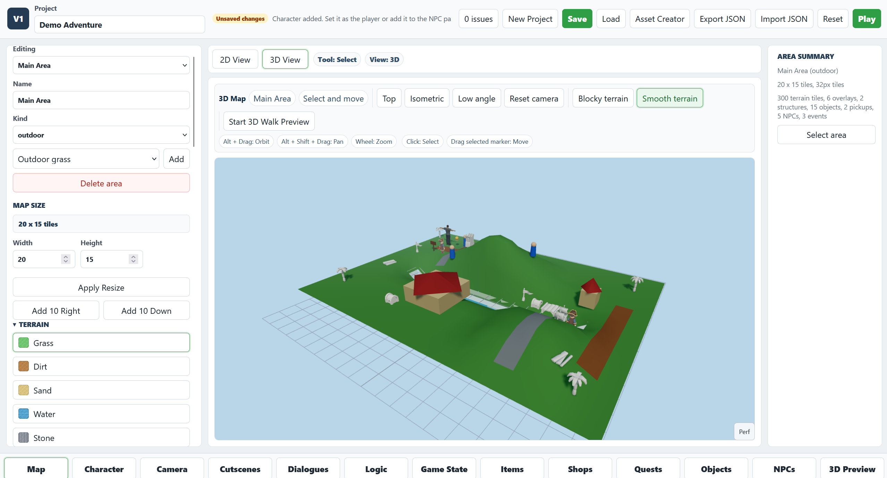
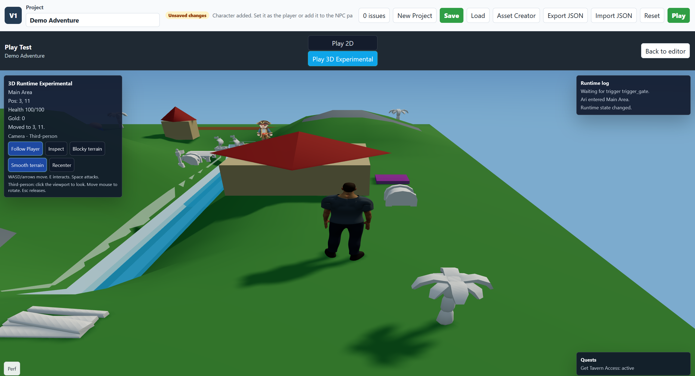
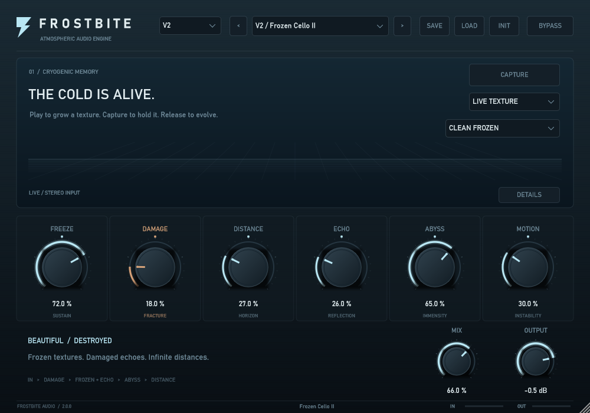
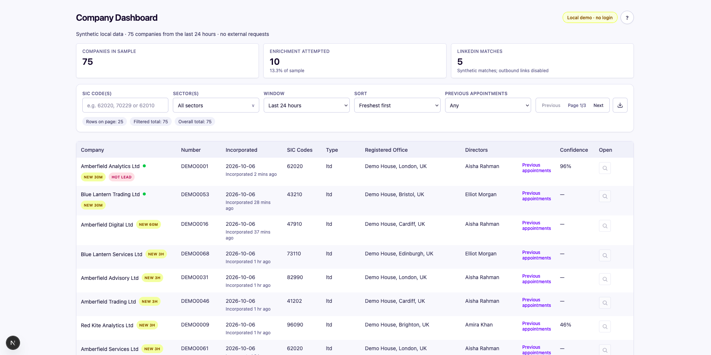
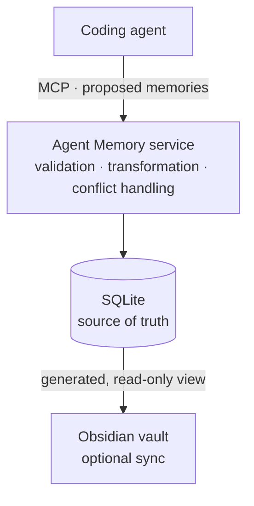
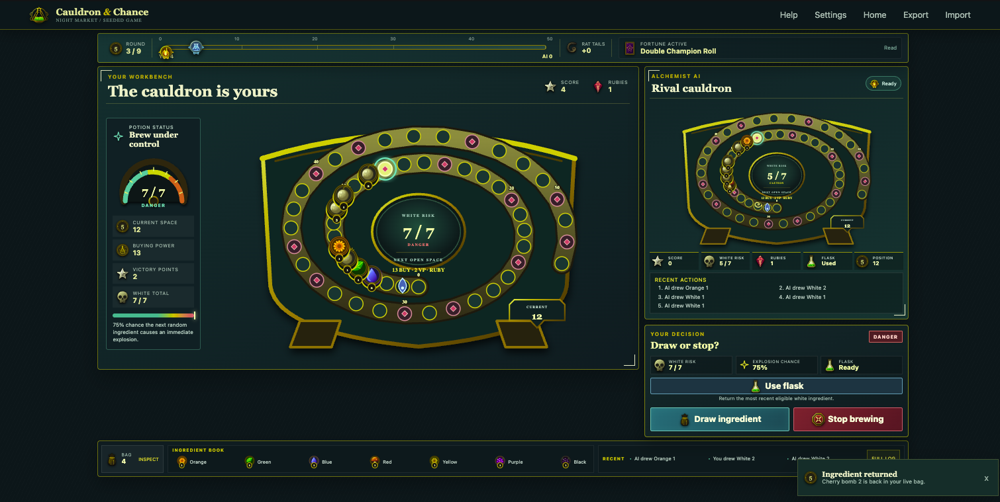

# James Crick

**Full-stack software engineer specialising in backend, cloud and event-driven systems.**

I build products end to end, with a commercial focus on backend, cloud and serverless systems. Outside work, I explore agent infrastructure, game engines, graphics tooling and audio software, with a particular interest in AI development workflows and long-term agent memory.

[LinkedIn](https://www.linkedin.com/in/james-crick-675a2516a/)

**AWS Certified Solutions Architect – Associate** · MSc Computer Science (Distinction), Queen Mary University of London

## Toolkit

  
  
  
  
  
  
  
  
  
  

**Core:** TypeScript · JavaScript · Python  
**Backend & cloud:** Node.js · AWS · PostgreSQL · serverless · event-driven systems  
**Product & graphics:** React · Next.js · Three.js · Phaser · SwiftUI  
**AI tooling:** MCP · agentic systems · RAG · LangGraph · long-term memory

**Currently exploring:** Rust · Swift · Go

## Featured work

### [Adventure Game Builder](https://github.com/kudrekode/pirate-game-engine)

Browser-based 2D/3D adventure-game editor and runtime built with React, TypeScript, Three.js and Phaser. It brings authored characters, data-driven game systems and a shared editor/runtime architecture into one creative tool.

  
  

### [Frostbite Audio Plugin](https://github.com/kudrekode/frostbite-audio-plugin)

A Windows x64 VST3 effect built with C++20 and JUCE for live and held granular textures, ping-pong echo, nonlinear damage and stereo ambience. Its real-time DSP avoids callback allocation, locks and I/O; V2 preserves existing presets and state while adding new factory sounds, with automated DSP, UI and VST3-host verification.

### [Companies House Enrichment Pipeline](https://github.com/kudrekode/ComapniesHouse)

An incremental Companies House ingestion and enrichment system designed for operational reliability: durable state, watermarks, replay-safe writes, run locking, cached officer data and a Postgres-backed enrichment worklist.

### [Agentic Memory Orchestrator](https://github.com/kudrekode/agentic-memory-orchestrator)

Local long-term memory infrastructure for coding agents. An MCP service where agents propose memories while a deterministic server validates, deduplicates and persists semantic, episodic, working-state and procedural memory—with optional Obsidian sync.

**Python · MCP · SQLite · Obsidian · 115 tests**

### [Cauldron & Chance](https://github.com/kudrekode/quacks-game)

A deterministic strategy-game engine with seeded randomness, hidden-information handling and an information-set Monte Carlo AI opponent. Built around reproducibility, worker isolation and a well-tested rules engine.

## Elsewhere

I’m also experimenting with mobile and systems tooling in [RetroFeed](https://github.com/kudrekode/retrofeedApp), a SwiftUI client backed by a Rust/Axum API.

_When I’m not building, I’m usually playing guitar._
